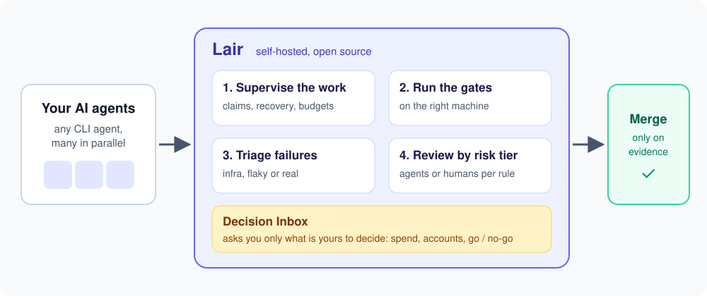

# Lair

**Run a fleet of AI coding agents, and only merge what is proven to work.**

[](https://github.com/behloleaqil1/lair/actions/workflows/ci.yml)
[](LICENSE)

[](https://github.com/behloleaqil1/lair/issues?q=is%3Aopen+label%3A%22good+first+issue%22)

AI agents can write code quickly; the hard part is knowing that what they ship actually works. Lair is a self-hosted
control room for many agents working on one repository at once. It supervises their runs, runs and triages the quality
gates, reviews changes by risk tier, merges only on evidence, and asks you only the decisions that are yours.



- **Many agents, one repository.** Claims so no two agents take the same task, recovery of hung or crashed runs,
  failover between agent CLIs on rate limits, and token and cost budgets.
- **Gates you can trust.** The gate queue across your machines, each failure triaged as infrastructure, flaky,
  pre-existing or a real failure of the change, and one automatic re-check of infrastructure failures.
- **Reviews and merges by policy.** Each pull request gets a risk tier with its required reviews (by agents or humans)
  and merges only at a head whose gate passed.
- **You decide only what is yours.** Spend, accounts, credentials and go/no-go wait in one Decision Inbox, each with
  its options and a recommendation.

Lair is **agent-agnostic** (agents are started by commands you configure) and **early (0.x)**: it is used every day
to build a real multi-service product, and much of the [design](docs/design/) is still ahead. New words such as
"dragon" or "lane" are in the [glossary](docs/glossary.md).

## Quick start

You need macOS or Linux, Node.js 22 or 24, npm and Git.

```bash
git clone https://github.com/behloleaqil1/lair.git
cd lair
npm install
npm run build
npm start
```

Open `http://localhost:4777`. Lair starts with the bundled `example` project, which reads synthetic files in
`fixtures/`, so you can click through every section right away. Start Lair from the repository root: it reads
`projects/` and writes its state to `data/` relative to the current directory. [Getting Started](docs/getting-started.md)
walks through your first own project.

## Use it with your own agents

Lair works from files and commands you already have, so it fits beside your agents and CI instead of replacing them:

1. **Point Lair at your project:** in the dashboard, **Settings > New project** checks your repository and writes the
   project file; or copy `projects/example.yaml` to `projects/local/<name>.yaml` and edit the paths
   ([Configure your project](#configure-your-project)).
2. **Get your agents' status in**, either way:
   - **the fleet bus**, an MCP server most agent CLIs can start from their MCP config; agents then call `claim`,
     `report` and `send` ([Fleet bus](docs/agents.md#fleet-bus-mcp)); or
   - **a queue file** the agent or a small wrapper appends lines to, such as `- DONE fix-login by agent-A 14:35Z: summary`
     ([Queue file format](docs/agents.md#queue-file-format)).
3. **Optionally let Lair start agents and run gates** by setting the commands in the project file (controls are off by
   default).

**Agent support:** the default adapter has been tested with Kiro. Adapters for **Claude Code, Cursor and Aider** exist
but need testers: if you use one of them, trying it and reporting what breaks is one of the most useful contributions
right now ([help wanted](https://github.com/behloleaqil1/lair/issues?q=is%3Aopen+label%3A%22help+wanted%22)).

## Contributing

Contributions are very welcome, from a typo fix to a module.

- **Start here:** [good first issues](https://github.com/behloleaqil1/lair/issues?q=is%3Aopen+label%3A%22good+first+issue%22)
  and [help wanted](https://github.com/behloleaqil1/lair/issues?q=is%3Aopen+label%3A%22help+wanted%22).
- **Questions and ideas:** [Discussions](https://github.com/behloleaqil1/lair/discussions).
- **How we work:** [CONTRIBUTING.md](CONTRIBUTING.md) (setup, checks, commit messages, the no-private-details rule)
  and the [Code of Conduct](CODE_OF_CONDUCT.md). Bigger features start from their design note in
  [docs/design/](docs/design/) and the order in the [roadmap](docs/design/ROADMAP.md).

<details>
<summary><strong>What each section of the dashboard does</strong></summary>

Home, Work, Gates, PRs, Machines, Decisions, Delivery, Processes and Settings; a section whose module is off for the project is left out of the nav. Every row opens its detail, with a URL you can share (`#/work/<agent>`, `#/gates/<id>`, `#/prs/<n>`, `#/decisions/<id>`); logs and test output are shown to the owner only.

- **Home**: what needs you (open decisions, holds, failed gates, PRs ready to merge, config problems, agents in trouble), the fleet at a glance, problems, merges and recent activity; tabs for the activity feed and audit log, and Health
- **Work**: every agent in one list, with its current run or task, and tabs for fill's tasks file and, with the planner on, how Lair keeps it; an agent's detail has its task, the run (state, model, started, recoveries, claims), what it waits on, holds to release, recent runs and its log
- **Gates**: the gate queue (any lane), recent results, and tabs for Lair's pipelines, Triage and Placement; a gate's detail has its track, commit, branch, lane and machine, each step's result and duration, triage's verdict, placement's advice, and for the owner the failing tests and the log
- **PRs**: open pull requests and their merge readiness. With reviews on (`review.enabled`), a PR is "Merge ready" only when the review module allows its merge at the head, and otherwise waits with the first reason; without reviews it only says whether the gate passed. A PR's detail has its tier and rules, required reviews and who holds each, findings, the gate at the head and the merge
- **Machines**: the project's machines with their runners and placement's probes, and connected lair-node daemons (experimental)
- **Decisions**: the Decision Inbox, the one place Lair asks you something (pricing, legal, spend, accounts, credentials, go/no-go, and problems its playbooks couldn't fix). Each decision shows what it blocks, its options with their consequences and a recommendation; the nav shows how many wait for you ([details](docs/configuration.md#decision-inbox)). Your messages to and from the orchestrator are its Owner messages tab
- **Processes**: the helper processes Lair supervises, when the project defines some
- **Health** (a tab of Home): the progress watchdog. It is off by default, and observe-only until you opt in. It detects hung or duplicate agents, stale locks and claims, orphaned gates, broken lanes, idle capacity, stalls and crash loops, and recovers through your own commands ([configuration](docs/configuration.md#watchdog))
- **Delivery**: your application's environments (docker compose projects). Bring them, or one service, up and down; Lair deploys changed services after a merge and rolls them back when they aren't healthy in time, never starts a service you stopped until you release it, and stops restarting a crash-looping one ([configuration](docs/configuration.md#delivery))
- **Agents** (in Work): agent runs Lair starts and supervises, off by default. One claim per task and pid-owned locks (a dead holder's lock is broken and logged), never-started runs retried, hung or dead-on-start agents restarted in the same session and then a fresh one, failover to another agent CLI or provider on rate limits, and per-agent and per-project token and cost budgets ([configuration](docs/configuration.md#agents))
- **Triage** (in Gates): why a gate failed. Each failure is parsed from test reports and logs into causes and classified as infrastructure, pre-existing, flaky or a real failure of the change, with its evidence. Infrastructure gets one re-check of only the failed tests, a red default branch is bisected to the merge that broke it, and a proven culprit is reverted or proposed for revert. Off by default ([configuration](docs/configuration.md#triage))
- **Placement** (in Gates and Machines): for a project with its own gate queue and runners on several machines, which machine runs each queued job. Lair probes the machines (a machine counts as up only after a few minutes of passing probes), learns how long each kind of job takes on each machine, estimates every job's start and finish, and moves a job to another machine's lane through your own mover when it would finish sooner there. Observe-only until you opt in ([configuration](docs/configuration.md#placement))
- **Settings**: every project setting from the dashboard, for the owner only: forms drawn from each module's schema and a YAML tab, each change checked by the same parsers as the server before it is written, commands it adds confirmed, secrets refused, a hand edit never overwritten, every version kept with Restore, and **New project** ([configuration](docs/configuration.md#settings))

</details>

## Requirements

- macOS or Linux
- Node.js 22 or 24 (the versions CI tests; Node 20 is end-of-life and not supported) and npm
- Git
- A C/C++ toolchain only if npm can't download a prebuilt `better-sqlite3` binary for your platform

For development with hot reload, run `npm run dev` and open `http://localhost:5173` instead of port 4777.

## Configure your project

Each monitored project is a YAML file. The quickest way is **Settings** in the dashboard (signed in as the owner): **New project** checks the repository, reads its GitHub repo from the remote and writes `projects/local/<id>.yaml`, and the forms change every setting after that, with each change checked, its commands confirmed and every version kept ([Settings](docs/configuration.md#settings)). By hand, put your own in `projects/local/` (gitignored), starting from the example:

```bash
mkdir -p projects/local
cp projects/example.yaml projects/local/myproject.yaml
```

```yaml
# projects/local/myproject.yaml
name: MyProject
repo: /path/to/repo
github: owner/repo-name
queue_file: /path/to/queue.md
agents_dir: /path/to/agents
gates_dir: /path/to/gates

machines:
  local:
    name: Workstation
    type: local
    runners: [heavy, light]
```

Project files end in `.yaml` or `.yml` (both the server and the bus load either; `.yaml` wins if both exist). The server picks up new and changed project files without a restart, and an invalid change keeps the previous config running with a banner saying why ([Live config reload](docs/configuration.md#live-config-reload)). The owner can restart Lair from the dashboard's footer when a service manager runs it ([Restart and update](docs/configuration.md#restart-and-update)). To open your project by default instead of `example`, start the server with `LAIR_PROJECT=myproject` (an unknown name logs a warning and is ignored). See [Getting Started](docs/getting-started.md) for a walkthrough and [Configuration](docs/configuration.md) for every option (machines over SSH, controls, merge bar, dragons, process manager).

## Connect an agent

There are two ways to get an agent's status into Lair:

1. **Queue file**: the agent (or a wrapper script) appends lines such as `- DONE fix-login by kiro-A 14:35Z: summary` to the project's `queue_file`.
2. **Fleet bus**: the agent connects to Lair's MCP server and calls tools such as `claim`, `report` and `send`. The bus isn't published on npm; run it from your Lair checkout:

   ```bash
   LAIR_AGENT_ID=kiro-A npm run --silent bus -- --project myproject
   ```

To start and stop agents from the UI, set `read_only: false` and configure `dragon_start_cmd` and `dragon_stop_cmd`. See [Agents](docs/agents.md) for the queue format, the MCP tools, an MCP client config example and start scripts.

## Controls

By default everything is **read-only**. Set `read_only: false` in a project config to enable controls. Each control runs one command from the project config, as an argument array (never through a shell), and is logged to `data/audit.log`.

In the UI:

- **Command bar**: *Ask* runs `ask_cmd` (read-only query), *Instruct* sends a message to the orchestrator, *Task* starts an agent with `agent_run_cmd`
- **Dragons**: start a dragon with a task (`dragon_start_cmd`) and stop it (`dragon_stop_cmd`)

The API (`/api/controls/*`) also has endpoints without UI buttons yet: orchestrator pause/resume and run a tick now, agent stop and release a task, submit a gate and mark a gate as stuck, and merge a PR (`merge_cmd`). Lair does not check the `merge_bar` before merging, so your merge script should.

Only stopping a dragon asks for confirmation; other controls run when clicked.

## Status and limitations

Lair is early software (0.x). The dashboard, the controls listed above and the fleet bus are the most complete parts; others are experimental or unfinished:

- **lair-node** (`lair-node` / `npm run node`) is a preview. It uses placeholder keys and runs a placeholder job command instead of the real task. It talks to the server over a plain, unencrypted WebSocket; nodes on other machines need `LAIR_NODE_TOKEN` (see [Security](#security)). `lair-node start` runs it in the background (log in `~/.lair/node/daemon.log`), `--foreground` in the terminal.
- **Job and gate signatures** are not end-to-end yet: the lair-node daemon signs with placeholder signatures, so its signed results prove nothing. Results that an existing gate system signs with `lair-node keygen` and `lair-node gate-result submit` are real Ed25519 signatures, which triage verifies ([Configuration](docs/configuration.md#results-from-an-existing-gate-system)).
- **Agent adapters** other than `kiro` (`aider`, `claude-code`, `cursor-agent`) are untested, and their command templates may not match your installed version. Adapters are descriptive today; agents start through `dragon_start_cmd`.
- **Gate pipelines** from a project's `pipelines:` block run from the Gates section or the API, on GitHub Actions runners first and on the local machine last ([Configuration](docs/configuration.md#gate-pipelines)). lair-node machines can't take pipeline jobs yet, runs start only by hand (no automatic triggers), and their results don't feed the merge policy yet.
- **Gate runner and merge policy** modules (`policy/`, `services/gate-runner.ts`, and the signing in `gates/`) are library code with tests, not yet wired into the running server.
- **Kiro conventions** remain in a few defaults: a dragon without `adapter:` uses the `kiro` adapter; the queue parser finds non-kiro agent IDs only in the `by <agent-id>` position (or a `(<agent-id>, ...)` prefix), while `kiro-X` IDs are recognised anywhere in a line; and the command bar's `tell <dragon-id> ...` form needs an ID with a `-` (`@<dragon-id> ...` works for any ID). Dragon IDs themselves can be any letter-first name (see [Configuration](docs/configuration.md#dragons-agents)).
- The design notes in [docs/design/](docs/design/) describe much more than is built.

Changes that need action when you upgrade are in [CHANGELOG.md](CHANGELOG.md).

## Security

In short: Lair listens on `127.0.0.1:4777` only, **has no authentication** (anyone who can reach the port can read your project data, and run the configured commands when controls are on), keeps controls off by default, and lets only a browser signed in as the owner answer decisions.

- The server binds to `127.0.0.1:4777` by default; `LAIR_HOST` changes the bind address. **Never set `LAIR_HOST` to a network or wildcard address on an untrusted network.**
- Answering decisions needs the owner token in `data/owner.token` (created at first start, readable only by your OS user). Run agents as a separate OS user so they can't read it.
- Cross-site browser requests and unexpected `Host` headers are refused (HTTP 403), which blocks DNS rebinding.
- lair-node connections from other machines need `LAIR_NODE_TOKEN`; the connection is still unencrypted.
- Controls run only commands from your config, as argument arrays. Lair never reads `.env` or credential files, and never stores SSH key contents.

[SECURITY.md](SECURITY.md) has the details (remote hosts, command execution, the owner session) and how to report a vulnerability privately.

## Scripts

| Command | Description |
|---------|-------------|
| `npm run dev` | Dev server (API + client with hot reload, UI on port 5173) |
| `npm run build` | Build the client and the server into `dist/` |
| `npm start` | Start the built server (API and UI on port 4777) |
| `npm run bus -- --project <name>` | Run the fleet bus MCP server (stdio) |
| `npm run node -- <command>` | lair-node CLI (experimental) |
| `npm test` | Run tests |
| `npm run lint` | Run ESLint |
| `npm run typecheck` | Run the TypeScript check |

## Documentation

- [Getting Started](docs/getting-started.md): installation and first project setup
- [Glossary](docs/glossary.md): the words Lair uses
- [Configuration](docs/configuration.md): full reference for all config options
- [Agents](docs/agents.md): connecting AI coding tools
- [Architecture](docs/architecture.md): components and data flow
- [Design notes](docs/design/): plans and feature designs (much of it not built yet)

## License

MIT, see [LICENSE](LICENSE).
