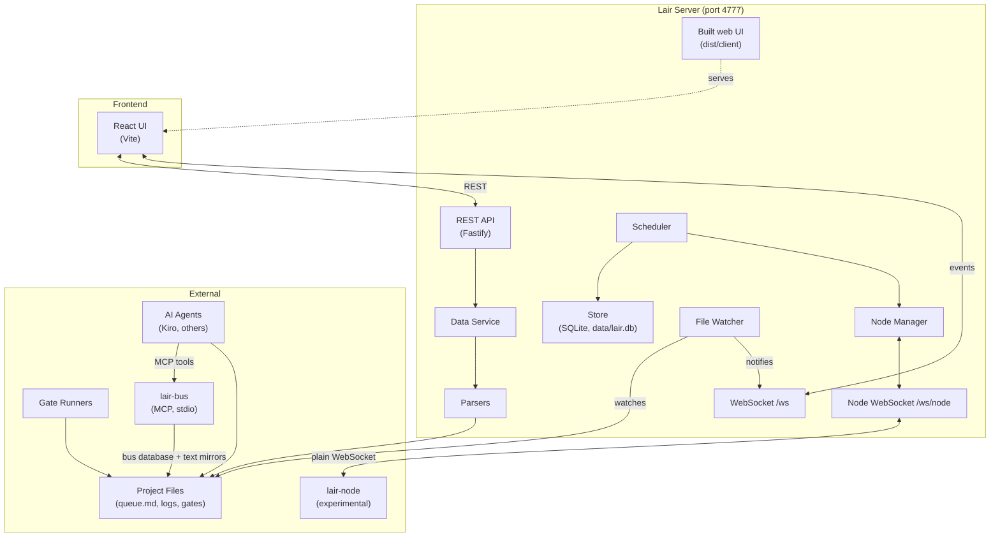

# Architecture

Lair is a control room for AI coding agent fleets. It provides visibility into agent status, gate queues, and infrastructure health through a real-time web interface.

## System diagram



In production (`npm run build && npm start`) the server also serves the built UI from `dist/client` on port 4777. In development (`npm run dev`) the UI is served by Vite on port 5173, which proxies `/api` to the server.

## Components

### Server (`src/server/`)

The Fastify-based backend that serves the API and manages state.

- **`index.ts`**: server entry point, route registration, lifecycle and graceful shutdown
- **`static.ts`**: serves the built UI (`dist/client`) with an SPA fallback, only when the build exists
- **`root-guards.ts`**: root request hooks (cross-site and `Host` checks on every route, `?project=` validation on API routes) and the `:id` path-parameter check
- **`origin.ts`**: allowed browser origins and `Host` names, the cross-site request hook, and the lair-node peer check (`LAIR_NODE_TOKEN`)
- **`config.ts`**: project YAML loader and project-name validation (`projects/<name>.yaml`; a file of the same name in `projects/local/` takes precedence)
- **`websocket.ts`**: WebSocket server for real-time UI updates (`/ws`)
- **`ws-upgrade.ts`**: one HTTP upgrade dispatcher that routes WebSocket handshakes to `/ws` or `/ws/node` by path

#### Routes (`routes/`)

- **`controls.ts`**: command bar and control buttons (ask, instruct, tick, pause/resume, agent run/stop/release, gate submit and mark stuck, merge, dragon start/stop, audit log)
- **`bus.ts`**: HTTP view of the fleet bus storage and an SSE event stream (`/api/bus/*`)
- **`processes.ts`**: process manager endpoints
- **`settings.ts`**: project settings endpoints
- **`scheduler.ts`**: scheduler, task and node endpoints
- **`fleet.ts`**: fleet management (machines, self-healing, budgets)
- **`project-guard.ts`**: shared `?project=` validation hook (HTTP 400 for an invalid or unknown project)

Each route module registers its routes in an encapsulated plugin with the cross-site check and the project guard.

#### Parsers (`parsers/`)

Pure functions that parse project files into typed structures:

- **`queue.ts`**: queue markdown into typed lines (WAITING, DONE, BLOCKED, PROGRESS, TICK)
- **`dragons.ts`**: agent status from `dragons.txt`, logs and the queue
- **`gates.ts`**: gate queue filenames, gate logs and results
- **`inbox.ts`**: inbox/outbox markdown
- **`dragon-config.ts`**: dragon registry and models from config
- **`adapter-config.ts`**: agent adapter and terminology configuration

#### Services (`services/`)

- **`data.ts`**: main data service, aggregates parsers for each view (read-only)
- **`command.ts`**: runs configured commands as argument arrays (no shell) and appends each action to `data/audit.log`
- **`dragon-registry.ts`**: the dragons a project has (YAML `dragons:` plus `dragons.txt`); start/stop requests are checked against it and the start dialog lists it
- **`adapters.ts`**: built-in agent adapter definitions and command builders (adapters are listed in the UI; dragons are started with `dragon_start_cmd`)
- **`supervisor.ts`**, **`managed-process.ts`**, **`ring-buffer.ts`**: process manager for long-running services and their logs
- **`file-watcher.ts`**: watches project files and broadcasts changes over the WebSocket
- **`gate-runner.ts`**, **`gate-distribution.ts`**, **`remote-gate.ts`**: optional gate runner, lane-to-machine distribution and remote gate execution over SSH (library code with tests; not started by the server yet)

#### Core (`core/`)

- **`event-bus.ts`**: internal event bus that decouples the node manager, scheduler, job manager, machine manager and healer

#### Machines (`machines/`)

- **`ssh.ts`**: SSH command builder. The local `ssh` call is an argument array; the remote command is one string for the remote shell, with every value single-quoted and gate env var names validated
- **`health.ts`**: machine reachability checks
- **`mapper.ts`**: lane-to-machine mapping (round-robin)

#### Fleet (`fleet/`)

- **`machine-manager.ts`**: adding, removing and monitoring machines
- **`healer.ts`**: self-healing (failure detection, job rescheduling)
- **`budget.ts`**: provider cost tracking, rate limits and pausing; cost listeners get each cost with its project and agent

#### Agents (`agents/`)

Agent runs with claims, locks, session recovery, failover and budgets ([configuration](configuration.md#agents)). Off unless a project sets `agents.enabled`.

- **`probes.ts`**: the watchdog's probes plus a `ProcessSpawner` (child_process.spawn, detached, no shell) and `ProcessSnapshot`, which judges an owner by pid and start time
- **`locks.ts`**: pid-owned lock files (exclusive create, hand-over, race-safe removal) and legacy pid-only or pid-less locks
- **`store.ts`**: runs, claims (one per task, claimed in an immediate transaction), events and the usage ledger in SQLite (`data/agents.db`)
- **`failover.ts`**, **`budgets.ts`**, **`sessions.ts`**: profiles and failover patterns; per-agent and per-project budgets per UTC day and month; session directories moved aside and resume summaries
- **`decisions.ts`**: the Decision Inbox interface the agents module raises `spend` and `escalation` decisions through, with an inbox-file fallback
- **`service.ts`**, **`routes.ts`**: the per-project tick (launch, supervise, recover, reap) started and stopped by `index.ts`, and `/api/agents/*`

#### Decisions (`decisions/`)

The Decision Inbox ([configuration](configuration.md#decision-inbox)): the one place Lair asks the human. Always mounted.

- **`types.ts`**: the `DecisionProducer` interface other modules use: `raise` (deduplicated per project, module and key), `blockedOn` (is this work parked?), `onResolved` (resume with the answer, delivered again after a restart until the handler takes it) and `withdraw`
- **`validate.ts`**: input validation for decisions, answers and withdrawals; the kinds that can't have a default
- **`service.ts`**: `DecisionInbox`: answers (confirmation for spend and go/no-go; a credentials secret is stored only once the answer has won), expiry with defaults or overdue marks, the open-decision caps (per module, and per project for HTTP raises), delivery to producers (reopening a credentials answer whose secret is gone), the sweep timer
- **`secrets.ts`**: the `SecretStore` interface credentials answers go to, and the in-memory stub
- **`request-bridge.ts`**: decision requests in the design note's shape (`DecisionRequest`, string options, the old kind names) as inbox decisions: `InboxDecisionHook`, and the `decision.needed` listener `mountDecisions()` wires, through which gate pipelines raise their minutes-budget decision
- **`store.ts`**: decisions (and whether each was raised over HTTP), the work they block and their audit trail in SQLite (`data/decisions.db`)
- **`routes.ts`**, **`mount.ts`**: the `/api/decisions` routes (answering only with an owner session; no HTTP withdraw), and `mountDecisions()`, which `index.ts` calls to wire the store, routes, sweeps and producers (the watchdog)

#### Owner credential (`human-auth/`)

Who may use the routes only the human may use: answering decisions, and in reviews merging, human reviews, resolving findings and releasing holds ([configuration](configuration.md#decision-inbox)).

- **`human-auth.ts`**: `HumanAuth`: the owner token (`data/owner.token`, mode 0600) and its one-time setup link, browser sessions stored only as HMACs (`data/owner-sessions.db`), `verifyRequest()` (the `X-Lair-Owner-Session` header, the dashboard `Origin`, `Sec-Fetch-Site: same-origin`), and the `requireOwner()` / `requireDashboard()` route hooks, and `requireOwnerForChanges()`, the module-wide hook that makes every write of a route module (controls, bus messages, processes, settings, scheduler, fleet, delivery, pipelines) owner-only and leaves its reads open
- **`routes.ts`**: `/api/owner/*`: sign a browser in, check, list and sign out browsers
- **`cors.ts`**: the CORS options `index.ts` uses: the dev server's origins, but none for owner-only paths

#### Watchdog (`watchdog/`)

The progress watchdog ([configuration](configuration.md#watchdog)). It is off unless a project sets `watchdog.enabled`, and in observe mode unless it sets `mode: act`.

- **`probes.ts`**: the only system boundary: `ProcessTable` (`ps` via execFile), `FileSystem`, `CommandRunner` (execFile, never a shell) and `Clock`
- **`view.ts`**: one snapshot of a project's queue file, agents dir, gates dir and processes, with memoized reads
- **`detectors.ts`**: the nine detectors (stale locks, duplicate agents, hung agents, orphaned claims, infrastructure failure signatures, orphaned gates, idle capacity, progress stalls, crash loops)
- **`playbooks.ts`**, **`playbook-engine.ts`**, **`executors.ts`**: built-in playbooks (diagnose, act, verify), the engine that runs their steps, and the executors that re-check the breach on fresh data and run the project's configured commands
- **`escalation.ts`**: once-per-breach escalations as Decision Inbox items (run the playbook once more, or leave it to the human), with an `OWNER?` entry in the inbox file when no decision can be raised
- **`store.ts`**: breaches, runs, escalations, SLO status and samples in SQLite (`data/watchdog.db`)
- **`service.ts`**, **`routes.ts`**: the per-project tick loop started and stopped by `index.ts`, and read-only `GET /api/watchdog/*` routes

#### Delivery (`delivery/`)

Environments as docker compose projects ([configuration](configuration.md#delivery)). Off unless a project sets `delivery.enabled`.

- **`config.ts`**: the validated `delivery:` block (environments, services, health checks, start order, crash-loop window, deploy settings)
- **`compose.ts`**: argv builders and the parsers for `docker compose ps --format json` and `docker inspect`
- **`probes.ts`**: the system boundary: the watchdog's `CommandRunner` and `Clock`, and `HttpProbe` for HTTP health checks
- **`environment.ts`**: one environment: status reads (`unknown` when docker can't be read), restart-count sampling and crash-loop marks, Up / Down / Restart / Deploy / Release as recorded operations (a Down may run beside another one), rollback, the deploy after a merge, and the recovery of a deploy interrupted by a stop
- **`redact.ts`**: removes credentials from commands, output and log lines before they are stored or shown
- **`store.ts`**: holds, crash loops, restart samples, operations, the last commit seen, the commit each service was deployed at, and the last container names read, in SQLite (`data/delivery.db`)
- **`service.ts`**, **`routes.ts`**: the per-project tick loop started and stopped by `index.ts`, the `ContainerServices` view the watchdog reads (crash loops and holds), and the `/api/delivery/*` routes

#### Reviews and policy merge (`review/`)

Risk tiers, reviews bound to the head sha, the test integrity check and policy merge ([configuration](configuration.md#reviews-and-policy-merge)). Off unless a project sets `review.enabled`.

- **`config.ts`**: the `review:` block (tier rules, reviewers per tier, integrity options, merge settings)
- **`host.ts`**, **`github.ts`**: the git host interface and its GitHub REST provider (PRs, files, commits, checks, contents, compare, the host's merge)
- **`diff.ts`**, **`integrity.ts`**: unified diff hunks, and the test integrity heuristics (self-asserting tests, skips, weakened assertions, removed tests, loosened suites, swallowed errors)
- **`gate-source.ts`**: the required gate at the exact head, from host checks or from signed gate results (verified by `policy/policy-evaluator.ts`)
- **`git.ts`**, **`executor.ts`**: git through execFile, the merge method choice, the host merge, the local fast-forward or squash in a fresh clone, and the email allow-list check on every commit to be published
- **`ports.ts`**: the interfaces other modules implement (Decision Inbox, reviewer assignment), with event-bus defaults
- **`store.ts`**: reviews, findings, authors, holds, merges and reviewer requests in SQLite (`data/review.db`)
- **`service.ts`**, **`routes.ts`**: per-project evaluation, reviews, holds and merges, started by `index.ts`, and the `/api/review/*` routes
- **`testing/`**: stand-ins for the git host API and git used by the tests (not built)

#### Triage (`triage/`)

Failure triage, bisect and revert ([configuration](configuration.md#triage)). It is off unless a project sets `triage.enabled`, and runs no command unless it sets `mode: act`. `index.ts` calls `mountTriage()` with the owner credential and connects the Decision Inbox; the gate pipelines hand it each job's result (`gate.completed`).

- **`parsers/`**: evidence parsers over bounded input. `junit.ts` (JUnit XML, with a small linear XML reader in `xml.ts`), `gradle.ts`, `js.ts` (vitest and jest), `pytest.ts`; `index.ts` turns a gate result and its reports into causes
- **`text.ts`**: bounded lines, signatures, test keys, `Caused by` chains, stack frames, and grouping a context failure into one cause
- **`classifier.ts`**: the rules (infra, flaky, pre-existing, code), each verdict with its evidence
- **`bisect.ts`**: the bisect state machine over the merges since the last green commit
- **`adapters.ts`**: the interfaces triage needs from other modules (re-check executor, agent router, task sink, decision raiser, revert opener, capacity, the owner guard), the Decision Inbox adapter, and the built-in command, inbox-file and capacity adapters
- **`git.ts`**: read-only git (first-parent merges, a commit's parents and message, changed files, merge base, ancestry)
- **`store.ts`**: results, causes, test observations, actions, re-checks, tasks, flaky tests, incidents and protected merges in SQLite (`data/triage.db`)
- **`service.ts`**: per-project ingest, trust and decisions, each in one store transaction; commands and decisions run from an outbox kept in the store (so they survive a restart), outside the project's queue
- **`manager.ts`**, **`routes.ts`**, **`index.ts`**: the projects' lifecycle and trusted node keys, the `/api/triage/*` routes (signed results; `/api/triage/owner/*` for the owner), and `mountTriage()`
- **`testing/harness.ts`**: the fakes the tests use (command runner, clock, git), a signing node, and result builders

#### Store (`store/`)

- **`store.ts`**: SQLite store (better-sqlite3) for nodes, tasks, jobs, events and agent runs, at `data/lair.db`
- **`migrations.ts`**: versioned SQL migrations for the store

#### Scheduler and jobs

- **`scheduler/scheduler.ts`**: matches ready tasks to available node capacity
- **`jobs/job-manager.ts`**: task creation, job lifecycle and result processing

#### Nodes (`nodes/`)

- **`node-manager.ts`**: WebSocket handler for lair-node connections (`/ws/node`)

#### Gates and policy (`gates/`, `policy/`)

Gate pipelines from the project config and their executors ([configuration](configuration.md#gate-pipelines), [design](design/runners.md)), started and stopped by `index.ts`:

- **`gates/project-pipelines.ts`**: the `pipelines:` and `executors:` blocks, validated; each lane becomes a gate pipeline
- **`gates/pipeline-service.ts`**: runs, one job per lane; the selector (executor order, availability, the minutes budget, the `spend` decision); attempts, fallback, and resuming in-flight jobs after a restart
- **`gates/executors/`**: `github.ts` and `github-api.ts` (GitHub Actions over the REST API: dispatch, find, poll, cancel, logs, artifacts, minutes), `github-workflow.ts` (the workflow file Lair generates and its log markers), `local.ts` (argv spawner, capacity probe, worktrees), `types.ts` (the Executor interface and the boundaries tests fake)
- **`gates/run-store.ts`**: runs, jobs, attempts, unavailable executors and raised decisions in SQLite (`data/pipelines.db`)
- **`gates/decision-hook.ts`**: the interface the Decision Inbox implements; the default emits `decision.needed`
- **`gates/routes.ts`**: `/api/pipelines/*`

Library modules with tests, not exposed through the API yet:

- **`gates/pipeline-config.ts`**, **`gates/gate-executor.ts`**: gate pipeline configuration and step execution (also used by every pipeline executor, so results have one shape)
- **`gates/signature.ts`**: signing and verification of gate results (not end-to-end yet; see [Status and limitations](../README.md#status-and-limitations))
- **`policy/policy-config.ts`**, **`policy/policy-evaluator.ts`**, **`policy/merge-controller.ts`**: merge policy configuration, evaluation and a control-plane merge controller
- **`policy/risk-rules.ts`**, **`policy/reviewer-slots.ts`**, **`policy/merge-policy.ts`**: risk tiers from rules over paths, file kinds, size and labels; required reviewers per tier; and the merge conditions the review module enforces

### Client (`src/client/`)

React-based frontend built with Vite.

- **`main.tsx`**: entry point
- **`App.tsx`**: main app with navigation, view routing and the command bar
- **`App.css`**: styles

#### Components (`components/`)

Each view is a standalone component:

- **`Overview.tsx`**: repo status, problems, counts
- **`DecisionInbox.tsx`**: the Decision Inbox (open decisions with their context, links as text to copy, options and recommendation, a confirmation step for spend and go/no-go, a password field for credentials, history, signing in as the owner) and the nav badge with the open count. Its requests and answer rules are in `decisions-api.ts`; the owner session (sent as a header; kept in this origin's `localStorage`, or only in the page's memory under the Vite dev server) is in `owner-session.ts`
- **`OwnerSessions.tsx`**: the signed-in browsers, each with Sign out
- **`Dragons.tsx`**, **`DragonStartDialog.tsx`**, **`DragonStopDialog.tsx`**: agent list (running also for a run of the agents module, "managed by Lair"; the effective model, "(default)" when from `dragon_defaults`; the newest log's time), start and stop dialogs (view logic in `dragon-view.ts`)
- **`Gates.tsx`**, **`PipelineRuns.tsx`**: gate queue by lane (every lane the request files name), results of the last 24 hours newest first (view logic in `gates-view.ts`); pipeline runs with where each step ran, fallback reasons, CI minutes, executor availability and the workflow file
- **`PRs.tsx`**: pull requests with gate status and merge readiness
- **`Orchestrator.tsx`**: orchestrator ticks, STOP file, service status
- **`Machines.tsx`**: machine health, runner status
- **`Nodes.tsx`**: connected lair-node instances
- **`Processes.tsx`**: managed processes and their logs
- **`Activity.tsx`**, **`LiveFeed.tsx`**: fleet bus activity feed
- **`Health.tsx`**: watchdog SLO status, open breaches and playbook runs (read-only)
- **`Delivery.tsx`**: environments and services (state, health, restarts, holds, crash loops, error lines) with Up, Down, Restart, Deploy and Release, and the operations log. Its requests are built in `delivery-api.ts`
- **`SignInHint.tsx`**: the "sign in from Decisions" notice the views with owner-only actions show while this browser isn't signed in as the owner. Those views send their writes through `owner-actions.ts` (and `delivery-api.ts`), which add the owner session
- **`Reviews.tsx`**: per PR, the risk tier, required and present reviews, findings, the gate at the head, holds and the merge button with its reasons (view logic in `review-view.ts`, requests in `review-api.ts`, owner-only ones with the owner session)
- **`Agents.tsx`**: per agent its state, run, claims, budget and recoveries; locks and their holders. Release a claim or start a fresh session, after a confirmation (`agents-actions.ts`)
- **`Triage.tsx`**: gate failures with each cause's verdict, evidence, actions and retry count; the default branch's incident and bisect, with revert and protect buttons
- **`Inbox.tsx`**: the "Owner messages" view (`inbox_file`: the owner's instructions and the orchestrator's replies; decisions are in Decisions). The nav labels are in `nav.ts`
- **`CommandBar.tsx`**: ask / instruct / task command bar
- **`Settings.tsx`**: project configuration UI

#### Hooks (`hooks/`)

- **`useApi.ts`**: data fetching with polling and error handling
- **`useWebSocket.ts`**: WebSocket subscription management
- **`useBusEvents.ts`**: SSE subscription to fleet bus events

### Shared (`src/shared/`)

Types shared between server, client, bus and node:

- **`types.ts`**: project config and view types
- **`decision-types.ts`**: Decision Inbox decisions, kinds (and which can't default or need confirming), answers and audit entries
- **`bus-types.ts`**: fleet bus events
- **`server-types.ts`**: nodes, jobs, tasks, scheduler, events, and the node wire protocol
- **`node-types.ts`**: lair-node local configuration and capacity types
- **`fleet-types.ts`**: machines, healing, budgets
- **`policy-types.ts`**: gates, policies, verification
- **`review-types.ts`**: reviews, findings, risk tiers and merge conditions as the review API returns them
- **`process-types.ts`**: process manager
- **`version.ts`**: the Lair version string

`src/types/sql.js.d.ts` and `src/bus/sql-types.d.ts` hold type declarations for sql.js.

### Fleet Bus (`src/bus/`)

MCP server (stdio) for direct agent-to-Lair communication. Run it with `npm run bus -- --project <name>`.

- **`cli.ts`**: CLI entry point (`lair-bus`)
- **`project-config.ts`**: finds and reads `projects/[local/]<name>.yaml` or `.yml` (same lookup order as the server)
- **`server.ts`**: MCP server and its tools (whoami, claim, release, report, inbox, ack, send, board)
- **`storage.ts`**: SQLite storage via sql.js (`data/<project>.db`)
- **`mirror.ts`**: mirrors reports and messages into the project's text files
- **`types.ts`**: bus types and input schemas
- **`index.ts`**: module exports

### Node daemon (`src/node/`, `src/cli/`), experimental

- **`cli/node.ts`**: `lair-node` CLI (`join`, `start`, `stop`, `status`)
- **`node/index.ts`**: the daemon: connects to `/ws/node`, registers, sends heartbeats, runs jobs
- **`node/registration.ts`**: node identity and config in `~/.lair/node/`
- **`node/capacity.ts`**: CPU, memory, disk and container runtime detection
- **`node/job-runner.ts`**: runs jobs as a process or in a container

## Data flow

### Polling (default)

```
UI → API request → DataService → Parsers → Project files
                                    ↓
                              Typed data
                                    ↓
UI ← API response ← JSON response ←
```

The UI polls every 10 seconds by default.

### WebSocket (real-time)

```
Project files change
        ↓
FileWatcher detects
        ↓
WebSocket broadcast
        ↓
UI receives update
```

The UI subscribes to channels (`dragons`, `gates`, `machines`, `orchestrator`, `logs:dragon-id`) and receives instant updates.

### Command execution

```
UI → Control action
        ↓
CommandService checks read_only and the configured command
        ↓
Executes as argument array (no shell)
        ↓
Appends an entry to data/audit.log
        ↓
UI ← Result
```

## Security model

1. **Localhost only**: the server binds to `127.0.0.1:4777` by default
2. **No authentication**: anyone who can reach the port can use the API, so never bind it to a network or wildcard address on an untrusted network
3. **Browser checks**: cross-site requests (foreign `Origin`) and foreign `Host` headers get HTTP 403, on HTTP routes and WebSocket handshakes (`origin.ts`); `LAIR_HOST` extends the allowed names, and a wildcard bind turns the `Host` check off but adds no allowed origin (remote browsers get read-only GETs; their POSTs and WebSockets are refused)
4. **Input validation**: invalid or unknown `?project=` names, unsafe gate or dragon IDs, and dragon start/stop requests for a dragon that is neither in the YAML `dragons:` map nor in `dragons.txt` get HTTP 400
5. **Node peers**: `/ws/node` accepts loopback peers, and remote ones only with `LAIR_NODE_TOKEN`
6. **Read-only default**: controls are disabled until `read_only: false`
7. **Argument arrays, not a shell**: controls, dragon start/stop, the process manager and local gate scripts run as argument arrays, preventing injection. Two exceptions, both for commands from your own config: the legacy `ssh_cmd` machine setting runs through the local shell (`services/data.ts`), and commands sent over SSH, such as remote gates, are one string for the remote shell with every value single-quoted (`machines/ssh.ts` `buildGateCommand`)
8. **No credential storage**: SSH keys are paths, never contents
9. **Audit logging**: control actions are logged to `data/audit.log`

See [SECURITY.md](../SECURITY.md) for details.

## lair-node (experimental)

The lair-node daemon runs on a machine in the fleet and connects to the server:

```
Control plane (lair-server)
        ↕ WebSocket /ws/node
lair-node (machine 1)      lair-node (machine 2)
    ↓                           ↓
Agent sessions             Gate jobs
```

What works today: the node registers, reports capacity (CPU, memory, disk, container runtime), sends heartbeats and receives job assignments. Not done yet: node keys and job signatures are placeholders, the job command is a placeholder, and the connection is not encrypted. Remote nodes must present `LAIR_NODE_TOKEN`; nodes on the server's own machine need no token.

See [docs/design/node.md](design/node.md) for the design.
